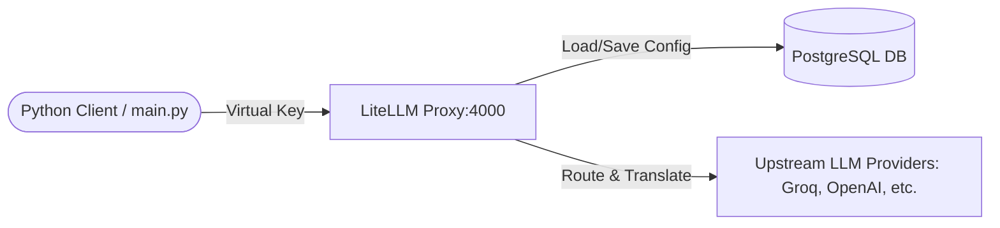

# LLM Gateway

A self-hosted, lightweight API gateway and router for Large Language Models (LLMs) built on top of [LiteLLM](https://github.com/BerriAI/litellm) and PostgreSQL. This setup allows you to centralize LLM API requests, manage virtual api keys, and dynamically store/route models via a centralized database.

---

## Architecture Overview



1. **LiteLLM Proxy Server**: Intercepts requests, enforces authentication using virtual keys, and forwards requests to upstream model providers.
2. **PostgreSQL Database**: Stores virtual keys, users, and routing configurations dynamically.
3. **Client Code**: Integrates with the proxy using the OpenAI/LiteLLM SDKs.

---

## File Structure

- `docker-compose.yml`: Launches the LiteLLM Proxy and PostgreSQL db containers.
- `main.py`: Client script demonstrating how to make a completion call through the gateway.
- `pyproject.toml`: Declares Python dependencies (`litellm[proxy]`).
- `.env.example`: Example environment variables configuration.

---

## Getting Started

Follow these instructions to get the LLM gateway up and running.

### 1. Prerequisites

Make sure you have the following installed on your system:
- **Docker** and **Docker Compose**
- **Python 3.12+**
- [uv](https://github.com/astral-sh/uv) (recommended Python package manager)

### 2. Start the Gateway Services

Run Docker Compose to start the PostgreSQL database and the LiteLLM Proxy server in the background:

```bash
docker compose up -d
```

Verify that the services are healthy. The LiteLLM proxy will be exposed at `http://localhost:4000`.

### 3. Set Up the Python Virtual Environment

Use `uv` to sync dependencies and initialize the virtual environment:

```bash
uv sync
```

Alternatively, using standard python:

```bash
python -m venv .venv
source .venv/bin/activate  # On Windows: .venv\Scripts\activate
pip install -e .
```

### 4. Configure Environment Variables

1. Copy the example environment template:
   ```bash
   cp .env.example .env
   ```
2. Copy the contents of .env.example to env and ensure `VIRTUAL_KEY` is set to your LiteLLM virtual key.

### 5. Running the Client Script

Execute the test script to make a prompt completion query through the gateway:

```bash
python main.py
```

The script initializes the LiteLLM client, targets your local proxy (`http://localhost:4000`), uses the `VIRTUAL_KEY`, and queries the routed model `groq/openai/gpt-oss-120b`.

---

## Gateway Configurations

The gateway environment variables are defined in `docker-compose.yml`:

| Environment Variable | Purpose |
| :--- | :--- |
| `LITELLM_MASTER_KEY` | Master key to manage the LiteLLM Proxy admin endpoints. |
| `LITELLM_SALT_KEY` | Key used to salt database credentials. |
| `DATABASE_URL` | Database connection string for PostgreSQL storage. |
| `STORE_MODEL_IN_DB` | Set to `"True"` to enable dynamic model/key configuration in PostgreSQL. |
